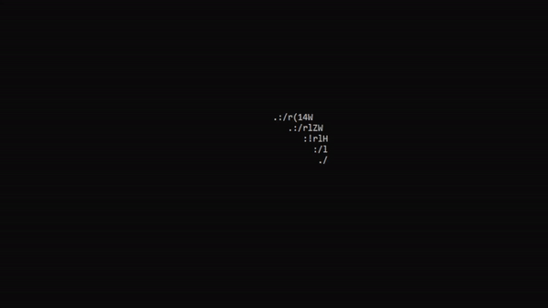
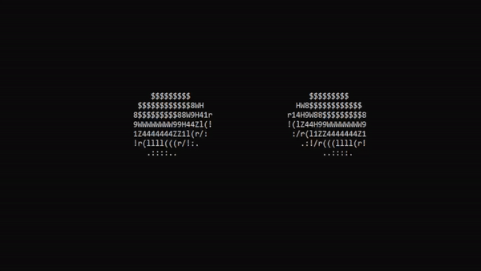
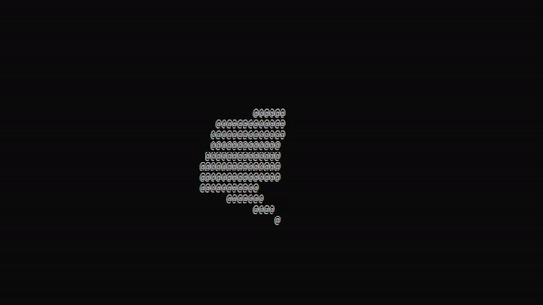

# AdyEngine

AdyEngine is a C# 3D graphics library for rendering scenes in a terminal. It provides cameras, materials, geometric primitives, collections, object movement, and collision checks.

## Features

- Chrome and color cameras
- Spheres, cubes, planes, lines, polygons, lights, and collections
- Scene objects that can be created, moved, and removed at runtime
- Collision queries between scene objects
- Console rendering with configurable material gradients and colors

## Requirements

- .NET 7 SDK

## Build

```sh
dotnet build AdyEngine.sln
```

## Quick start

Create a `Space` with a camera and a set of objects, then render it with `GetView`:

```csharp
using AdyEngine.ENGINE_OBJECTS;
using AdyEngine.ENGINE_OBJECTS.CAMERA.CHROME_CAMERA;
using AdyEngine.OBJECTS;
using AdyEngine._3D_OBJECTS.GEOMETRY.GEOMETRY_OBJECTS;
using AdyEngine._3D_OBJECTS.MATERIALS;
using Object = AdyEngine._3D_OBJECTS.GEOMETRY.Object;

var scene = new Space(
    new ChromeCamera(new Vector3(-4, 0, 0), new Vector3(0)),
    new List<Object>
    {
        new Sphere(new Vector3(0, 0, 0), new Vector3(1), Material.DefaultMaterial, "sphere"),
    });

scene.GetView();
```

Use `ColorCamera` when rendering colored materials. `Space` also exposes methods for retrieving, moving, creating, and deleting objects. Geometry can be assembled into `Collection` instances, and object collision queries can be used to react to intersections.

## Examples

The animated GIFs in this repository show lighting, movement, color rendering, collisions, collections, lines, and polygons. The source project is in [`AdyEngine`](AdyEngine/) and the solution is [`AdyEngine.sln`](AdyEngine.sln).

## Demos

Each animation below is stored in this repository and illustrates a rendered scene.

### Scene setup and geometry


### Materials, lighting, and motion







### Custom geometry



